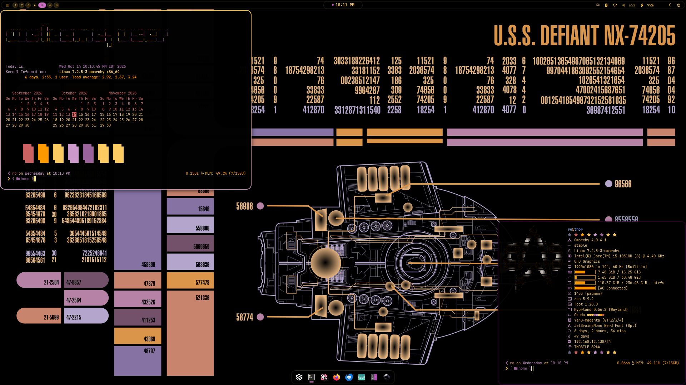
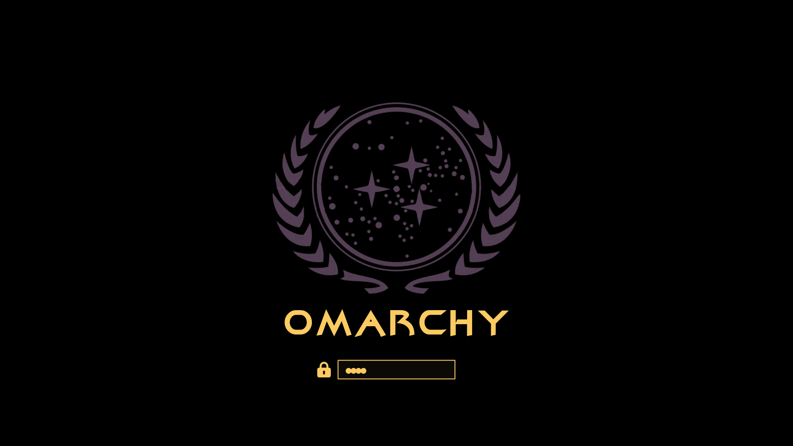

# Okuda

An unofficial Omarchy theme for Arch Linux and Hyprland inspired by LCARS — the
okudagram interface panels of **Star Trek**. True-black fields, amber readouts,
and the lilac and magenta pills of the ship's library computer.



## Highlights

- LCARS palette on a true-black background: amber `#ffce63` text with lilac
  `#ce9cce` and magenta `#cc6cc0` accents.
- Nine included wallpapers in the LCARS style — seven stills and two silent 4K
  animated loops — led by the **U.S.S. Defiant NX-74205** status board in
  `Defiant Status.jpg`.
- Animated Hyprland window borders blending lilac into amber at 45°.
- A `Yaru-magenta` icon theme, matched to the LCARS accent colours.
- A Plymouth unlock screen: the Starfleet crest over true black with the Omarchy
  wordmark in the Deep Space Nine title face.

## Installation

Install it from the repository with Omarchy:

```bash
omarchy theme install https://github.com/signaldirective/okuda
omarchy theme set okuda
```

You can also place the theme in `~/.config/omarchy/themes/` and set it with
`omarchy theme set okuda`.

## The palette

`colors.toml` is the source of truth. When the theme is installed from a
repository, Omarchy generates the shell, Hyprland borders, terminals, editors,
btop, and the desktop lock screen from that one file.

| Role | Colour | |
|---|---|---|
| `background` | `#000000` | true black — the LCARS field |
| `foreground` | `#ffce63` | LCARS amber readout |
| `accent` | `#cc6cc0` | magenta pill |
| `selection` | `#3e2243` | selected-text fill |
| `blue` | `#ce9cce` | lilac — the LCARS lavender |
| `brown` | `#390039` | deep aubergine segment |

Label and numeric readouts use amber, status pills use lilac, and emphasis uses
magenta — the same three-colour split the on-screen panels use, so a terminal
ends up reading like a console sitting inside the frame.

## Wallpapers

Nine wallpapers ship in `backgrounds/`, all 4K or larger — seven stills and two
animated loops:

| File | |
|---|---|
| `Defiant Status.jpg` | U.S.S. Defiant NX-74205 status board |
| `defiant.mp4` | U.S.S. Defiant NX-74205 status board, animated |
| `wallhaven-4gkjpe.png` | U.S.S. Defiant master systems display |
| `wallhaven-01zlw1.png` | U.S.S. Enterprise NCC-1701 master systems display |
| `wallhaven-0wrldx.jpg` | U.S.S. Zhukov NCC-26136, Ambassador class |
| `Deflector Shields.png` | “Deflector Shield Status” panel |
| `Enterprise D Engineering 4K.png` | U.S.S. Enterprise-D engineering panel |
| `4K.png` | U.S.S. Voyager NCC-74656 status board |
| `voyager.mp4` | U.S.S. Voyager NCC-74656 status board, animated |

Cycle them with `omarchy theme bg next`, or pick one from **Omarchy → Style →
Background**.

### Animated wallpapers

The two `.mp4` files are silent 4K loops. Playing them needs an Omarchy build
that renders video backgrounds — the **dev channel**:

```bash
omarchy channel set dev
omarchy theme bg set ~/.config/omarchy/themes/okuda/backgrounds/voyager.mp4
```

On the stable channel, run a video-wallpaper daemon instead. `awww` animates
GIFs, not video, so for these files use something like
[`mpvpaper`](https://github.com/GhostNaN/mpvpaper) (AUR):

```bash
mpvpaper -o "no-audio --loop" ALL ~/.config/omarchy/themes/okuda/backgrounds/voyager.mp4
```

Both loops ship without an audio track, so a player that would otherwise play
their sound has nothing to play.

## Unlock screen

The theme also ships the Plymouth disk-unlock screen: the Starfleet crest in
LCARS lilac above the Omarchy wordmark set in the Deep Space Nine title face,
with the passphrase field in amber on true black.



Pick it from **Appearance → Unlock**, or apply it directly:

```bash
omarchy-plymouth-set-by-theme okuda
```

## Icons

The theme sets `Yaru-magenta` through `icons.theme`, matching the LCARS accent
colours. If that icon set is not installed, Omarchy falls back to its default
and the rest of the theme still applies.

## Support

[Tip me on Ko-Fi](https://ko-fi.com/signaldirective)

## Disclaimer

Star Trek, LCARS, and related marks are trademarks of Paramount Global / CBS
Studios. Okuda is an unofficial, fan-made theme and is not affiliated with or
endorsed by them.
